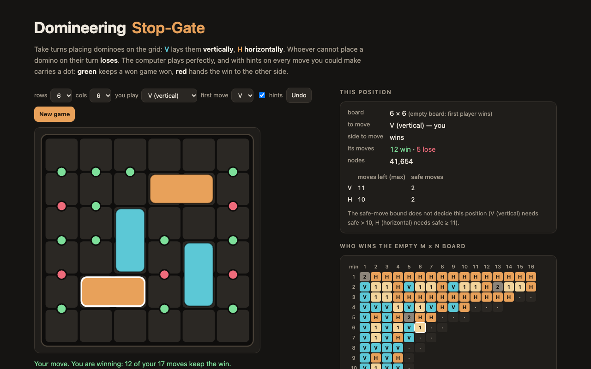

# Domineering — play a perfect player, and every m×n board up to 52 cells solved



**Domineering** (also Stop-Gate or Crosscram) is the classic game of combinatorial game theory. Two players take
turns placing dominoes on a grid: **V** lays them vertically, **H** horizontally. Whoever cannot place a domino on
their turn loses.

This page lets you play it against a perfect player on any board from 2×2 to 8×8 with at most 36 cells, as V or H,
with either side moving first. With hints on, every move you could make carries a dot: **green** keeps a won game
won, **red** hands the win to the other side. The side panel shows the safe-move bound for the current position
(below), and a chart of who wins every empty m × n board, recomputed here and checked against Nathan Bullock's
published chart.

TypeScript, no runtime dependencies. The solver runs in a Web Worker on the page and under Node for the chart.

## The solver

[`src/solver.ts`](src/solver.ts) decides one thing exactly: does the side to move win?

- **Two bitboards.** The occupancy is kept as row bitmasks *and* column bitmasks. A horizontal move is two adjacent
  free bits in a row, a vertical move two adjacent free bits in a column, so both players run the same code with the
  two arrays swapped.
- **Transposition table** with two slots per bucket (one keeps the entry with the larger subtree, one is
  always-replace), keyed by the smallest of the position's four mirror images. A position with up to 52 cells fits
  in one exactly representable double, so the key is a plain number, updated incrementally per move for all four
  mirror images at once.
- **History heuristic** for move ordering.
- **The safe-move bound**, tried before the table. A *safe* move is a free pair of cells the opponent can never
  cover: for V, two stacked cells whose left and right neighbours are filled or off the board. The opponent cannot
  take it away, and it does not interfere with other safe moves counted disjointly. Each run of *k* free cells in a
  player's direction holds at most ⌊*k*/2⌋ of its dominoes, which bounds how many moves that player can still make.
  With *p* to move and *o* the opponent:
  - safe(*o*) ≥ max(*p*): *o* can answer every move *p* could ever make — *p* loses;
  - safe(*p*) > max(*o*): *p* still has a move after everything *o* could ever do — *p* wins.

The page asks the worker for a verdict on every legal move of the side to move, with a per-move node budget so a
stubborn move cannot starve the rest; moves still open when the budget runs out are shown grey.

## The chart

H moving first on m × n is the same game as V moving first on the transposed n × m board. So the chart needs one
search per board shape — "does V win moving first?" — and each cell combines two of them:

| V first wins on m×n | V first wins on n×m (= H first on m×n) | outcome |
|---|---|---|
| yes | no | **V** wins whoever starts |
| no | yes | **H** wins whoever starts |
| yes | yes | **1** — first player wins |
| no | no | **2** — second player wins |

`npm run table` runs every m × n with at most 52 cells and both sides at most 30 under Node (one process per board,
in parallel), with a node budget per run, and folds the results into [`src/table.json`](src/table.json).
[`src/bullock.ts`](src/bullock.ts) is Bullock's chart ("Updated Game Theoretic Values for Domineering Boards",
University of Alberta), transcribed cell by cell.

### What came out

With a budget of 40 million nodes per run (Node 26 on a 12-core Mac mini, ten runs at a time):

- **144 of the 173 V-first runs finished**, so **140 boards have both first players solved**: 56 V, 56 H, 24 first
  player, 4 second player (1×1, 5×5, 2×13 and 13×2).
- **All 140 agree with Bullock's chart** — 108 read from the chart directly, and 32 boards with more than 11 rows
  (n×1, n×2, n×3), which the chart lists only as their transposes, read from the transposed cell with V and H
  swapped.
- The 29 runs that hit the budget are the boards of 40–52 cells: 7×7, 6×7, 6×8, 5×8 to 5×10, 4×11 to 4×13,
  3×15 to 3×17, 2×22 to 2×26 and their transposes (26×2 only — 22×2 to 25×2 finished).
- The hardest runs that finished: 4×10 (V first loses, 33.2 M nodes), 14×3 (V first wins, 29.8 M), 25×2 (26.9 M),
  10×4 (24.9 M), 3×14 (19.5 M). The empty 6×6 takes 2.81 M.

Nodes to decide "V first" with the bound and the symmetry folding switched off and on (`runs/ablation.jsonl`; the
seconds are not comparable because the runs shared the machine with the chart run):

| board | neither | symmetry only | safe moves only | both |
|---|---:|---:|---:|---:|
| 5×5 | 143,024 | 50,899 | 46,771 | 19,403 |
| 5×6 | 2,489,050 | 915,462 | 939,338 | 290,182 |
| 5×7 | 13,796,531 | 6,231,601 | 3,907,518 | 1,303,124 |
| 7×5 | 6,118,865 | 5,140,367 | 1,075,444 | 1,038,084 |
| 6×6 | 11,954,894 | 7,440,057 | 7,890,692 | 2,810,547 |

## Tests

`npm test` (vitest):

- the solver against plain minimax (no table, no bound, no ordering) on 600 random positions of boards up to 4×5;
- the safe-move bound and the symmetry folding never change an answer (all four on/off combinations, 150 random
  5×5 positions), and whenever the bound fires it agrees with plain minimax;
- `analyze()` marks a winning move exactly when the position is won;
- hand-checked CGT positions: 1×1 = 0, 2×2 = ±1, 2×3 = {2 | −½}, and the −½ position inside it;
- H first on m × n equals V first on n × m for every board up to 24 cells, and Bullock's chart has the same
  symmetry in all 121 of its m, n ≤ 11 pairs;
- every board with at most 30 cells, solved from scratch inside the test, matches Bullock's chart, and so does every
  cell of `src/table.json` that the batch run solved.

## Run it

```sh
npm install
npm run dev        # http://localhost:5173/portfolio/domineering/
npm test
npm run build      # static site in dist/
npm run table      # recompute the chart (long: many boards run to the node budget)
```

URL parameters: `r`, `c` (board size), `you=v|h`, `first=v|h`, `hints=0`, and `moves=a-b,a-b,…` (cell indices
`row * cols + col` of each domino, in order) to open a position.

## References

- Nathan Bullock, *Domineering: Solving Large Combinatorial Search Spaces*, M.Sc. thesis, University of Alberta,
  2002; and "Updated Game Theoretic Values for Domineering Boards",
  http://webdocs.cs.ualberta.ca/~games/domineering/updated.html
- D. M. Breuker, J. W. H. M. Uiterwijk, H. J. van den Herik, "Solving 8×8 Domineering", *Theoretical Computer
  Science* 230 (2000) 195–206
- Michael Lachmann, Cristopher Moore, Ivan Rapaport, "Who Wins Domineering on Rectangular Boards?", *More Games of
  No Chance*, MSRI Publications 42 (2002)
- E. R. Berlekamp, J. H. Conway, R. K. Guy, *Winning Ways for Your Mathematical Plays*

## License

MIT. Built by [SEN LLC](https://sen.ltd/).
